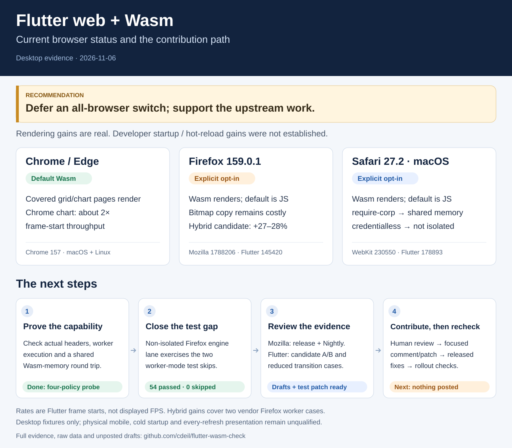
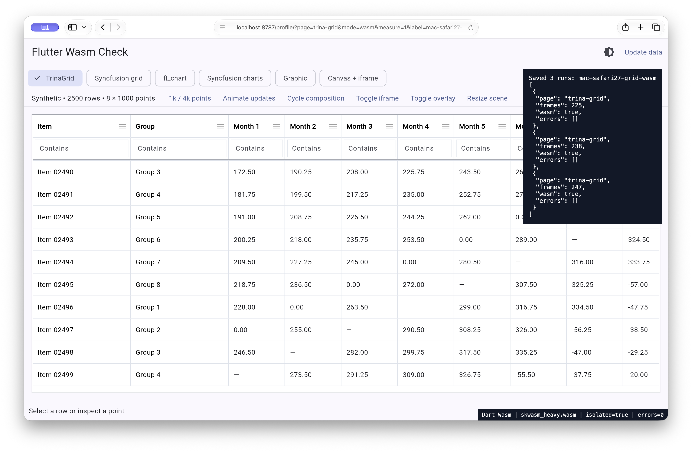
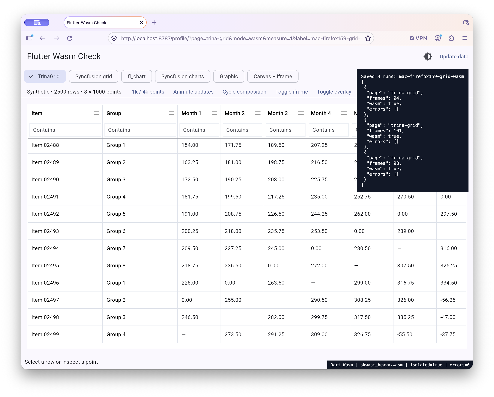

[Try Flutter Web with WebAssembly Week](https://flutter.dev/blog/try-flutter-web-with-webassembly-week)
prompted this check: do its readiness and performance claims translate to the
browser mix and interactive app that I actually need to support?

# Flutter Wasm Check

[](docs/followup-validation-2026-11-06.md)

The rendering gains are real, but they are workload-dependent. With meaningful
Firefox use and some Safari use, I do not yet consider an all-browser Wasm
switch ready. Both browsers can run opted-in Wasm; Flutter still selects its
JavaScript fallback for them by default. Running successfully, rendering quickly,
and being enabled/supported by default are separate questions.

This repository contains a small, synthetic dashboard app, repeated measurements
on macOS and Linux, and local experiments with the existing Flutter hybrid
presentation work. It is intended to make useful upstream contributions
reviewable. **No upstream issue comments or pull requests have been posted.**

Current Chrome 157 roughly doubles the heavy chart's frame-start throughput
in these profile runs. The article's 200-node demo now runs near 60 even with
JavaScript on both machines; Wasm building is about 2.3 times faster there,
but its exact FPS and jitter multipliers do not repeat. See the measured scope
and raw data below.

Real Safari 27.2 and installed Firefox 159.0.1, explicitly opted into Dart Wasm:

<p>
  
  
</p>

These prove rendered states. Repeated timing and transition evidence is in the
reports below; screenshots alone do not establish frame delivery.

## Try the app

Install [FVM](https://fvm.app/), Node.js and Git:

```sh
make setup
make build
make serve
```

Open <http://localhost:8787/release/>. The default build uses Flutter's stock
browser selection. `?mode=js`, `?mode=wasm` and `?mode=st` select JavaScript,
explicit experimental Wasm, and single-threaded Wasm respectively. The proof
label reads the compiler flag and loaded renderer; `canvaskit.wasm` alone does
not mean the Dart app is Wasm. The server uses `COOP: same-origin` and
`COEP: require-corp`; `COEP=credentialless make serve` supplies the other policy.

| Page | What to exercise |
| --- | --- |
| TrinaGrid 2.4.0 | 2,500 rows, monthly numeric columns, filters, sorting, editing, horizontal/vertical scrolling |
| Syncfusion DataGrid 35.1.43 | The same rows, sorting, filters, resizing and cell selection |
| fl_chart 1.3.0 | Eight sparse line series, hover/tap inspection, continuous data updates, 1,000/4,000-point controls |
| Syncfusion Charts 35.1.43 | The same series, native trackball, zoom/pan and continuous updates |
| Graphic 2.7.0 | The same series with explicit segments at missing observations, tooltips and updates |
| Canvas + iframe | Native input/HTML, Flutter overlay, resize and repeated single/multiple-canvas compositions |

Data is generated locally. There is no backend, account, analytics or credential
setup. Missing values, zeros and negative values remain distinct. The chart
adapters are deliberately small; this is not a feature-parity comparison of
chart libraries or a recommendation to replace a grid.

## Results and investigations

- [Measurements and method](docs/measurements-2026-11-06.md): raw timings,
  reference-demo rerun, bundle sizes, browser versions and limitations.
- [Browser readiness](docs/browser-readiness.md): capability floors, fallback,
  isolation, Safari status, and the remaining Firefox copy cost.
- [Hybrid-engine experiment](docs/hybrid-experiment.md): pinned candidate,
  local build procedure, bitmap/hybrid A/B results and composition checks.
- [Upstream investigation](docs/upstream-investigation.md): source paths,
  existing issues/PRs, what is worth contributing, and what is not a confirmed bug.
- [Follow-up validation](docs/followup-validation-2026-11-06.md): standalone
  isolation/shared-memory controls and a tested Firefox single-thread engine-lane patch.
- [Unposted drafts](drafts/): concise starting points for human review.
- [Sources and licenses](docs/sources.md): pinned Git submodules and package releases.

Wasm is an application compiler/renderer choice, not an established improvement
to developer startup or hot reload. This evaluation does not claim that those
times are identical or faster. Startup, API/network time, and real displayed
frame delivery need their own measurements.
In the pinned 3.47.9
[web runner](https://github.com/flutter/flutter/blob/c197ca5199e9ee5661e865596c9c07294dfab51c/packages/flutter_tools/lib/src/isolated/resident_web_runner.dart#L179),
Wasm reload requests use restart behavior; the runner also excludes Wasm from
its debug service-protocol path. A production Wasm build does not require using
Wasm for the ordinary JavaScript development loop.

## Reproduce the checks

```sh
make check
npx playwright install chromium firefox
node tool/bench.mjs chromium
node tool/copy.mjs chromium
bash tool/build-reference.sh
node tool/reference.mjs chromium
node tool/summarize.mjs output
node tool/size.mjs build/release
```

Set `BROWSER_PATH` to a vendor Chrome/Edge binary, `BASE_URL` for a remote server,
and `OUT` for a result file. Playwright Firefox is a patched build, not a way to
drive arbitrary installed Firefox. Safari checks use real Safari through
Computer Use, not Playwright WebKit. `?measure=1&label=your-label` runs three
native-browser samples and saves them to the local server's `output/native.jsonl`.
Keep the native browser foreground while it measures.
Set `FLUTTER_BIN` for the reference build if the pinned SDK is outside FVM's
usual `~/fvm/versions/3.47.9` cache. The hybrid build has separate prerequisites
and the explicit bootstrap limitation described in its report.

Submodules are optional source references, not build dependencies. Normal app
setup does not download Flutter/Firefox source. `make sources` initializes the
pinned sources, using a sparse Firefox checkout; expect substantial downloads.
Do not use `git submodule update --remote` for a reproduction.

## License

Original harness/app code is MIT. Dependencies and referenced sources retain
their own licenses. Syncfusion requires an appropriate Community or commercial
license; this repository does not grant one or distribute a license key. See
[the package license](https://pub.dev/packages/syncfusion_flutter_datagrid/license).
