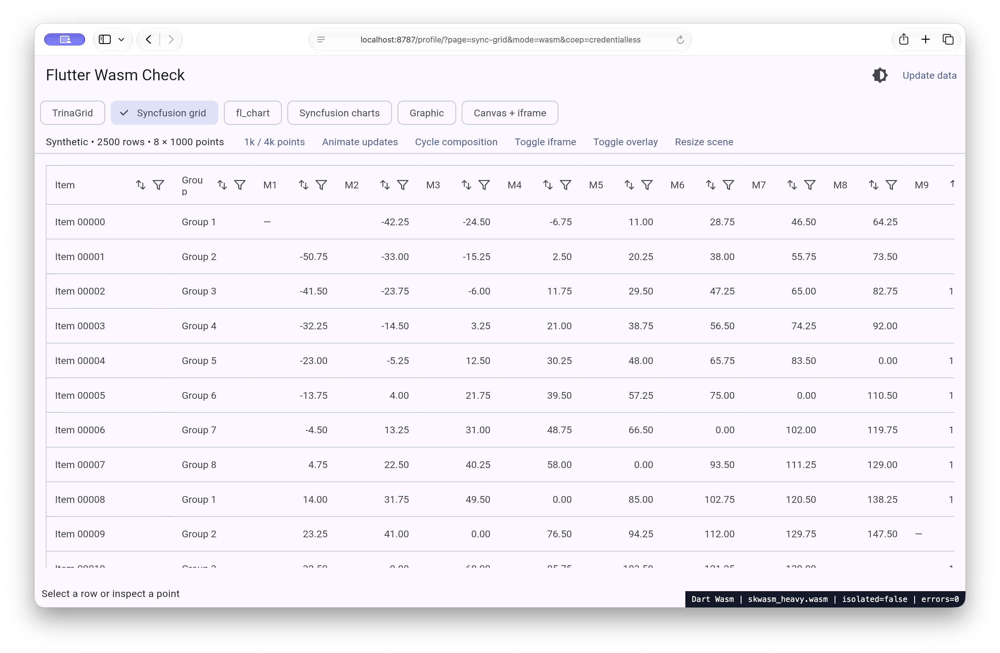

# Browser readiness — 2026-11-06

Wasm can render correctly in current Safari and Firefox. That does not mean
Flutter selects it by default, or that every presentation path is fast.

The [current Flutter guide](https://docs.flutter.dev/platform-integration/web/wasm)
describes Flutter 3.50's capability gates as Chromium 137+, Safari 26.2+ and
Firefox 147+. WebKit and Gecko remain off in the default allow-list. The pinned
3.47.9 loader and inspected 3.50 beta also retain those two default exclusions.
Do not backdate the 3.50 feature requirements to every older Flutter release.

Safari 26.2 shipped on
[2025-12-12](https://developer.apple.com/documentation/safari-release-notes/safari-26_2-release-notes),
including JS String Builtins. Firefox 147 shipped on
[2026-01-13](https://www.firefox.com/en-US/firefox/147.0/releasenotes/).
These are browser-feature dates, not dates when this app was fully qualified.

| Browser lane | What was actually established |
| --- | --- |
| macOS Safari 27.2 | Visible Wasm grids/charts, isolation/worker proof under `require-corp`, JavaScript controls, local candidate composition cycles |
| macOS installed Firefox 159.0.1 | Visible opted-in Wasm grid, default JavaScript fallback, bitmap cost reproduced |
| macOS/Linux Playwright Firefox 157 | Patched Playwright build used for automated app/compiler comparisons; not a substitute for vendor Firefox |
| Linux vendor Firefox 159.0.1 / Nightly 162.0a1 | Release binary renders all six pages in headless screenshots, retains default JS fallback, and runs same-candidate worker A/B; Nightly is a separate copy-probe check |
| Chrome/Edge | Stock Wasm selection works; package-specific rendering and interaction checks are recorded separately |

The [measurement record](measurements-2026-11-06.md) and raw JSON identify the
specific binary, build, viewport, runtime resources and test scope. A user-agent
label may be reduced or privacy-masked; it is not the installed patch version.
There is no claim of complete Windows or physical-phone qualification.

## Isolation is another independent gate

On the tested real Safari 27.2, `COEP: credentialless` with
`COOP: same-origin` left `crossOriginIsolated=false`. The app still rendered
with single-threaded Skwasm. `COEP: require-corp` produced isolation and a worker.
The Syncfusion grid remained visible with credentialless isolation unavailable.

The [standalone follow-up](followup-validation-2026-11-06.md) now checks an actual
shared Wasm-memory round trip in file and blob module workers. It confirms the
same Safari policy boundary. WebKit's missing credentialless policy is tracked
separately in [230550](https://bugs.webkit.org/show_bug.cgi?id=230550).

These local pages use same-origin assets and a same-origin iframe. They do not
qualify external embeds, sign-in popups, downloads, image origins, or third-party
services under isolation headers. Verify those integrations before a rollout.

## Remaining blockers

- [Mozilla 1788206](https://bugzilla.mozilla.org/show_bug.cgi?id=1788206):
  still NEW, unassigned, no target milestone. The transfer cost reproduces,
  including the current Nightly. It is a presentation cost, not lack of all Wasm support.
- [Flutter 145420](https://github.com/flutter/flutter/issues/145420): tracks
  adopting the single-context strategy across Firefox/Safari.
- [Flutter 178893](https://github.com/flutter/flutter/issues/178893): Safari
  default enablement remains open; a local success is not a default-policy change.
- [WebKit 267291](https://bugs.webkit.org/show_bug.cgi?id=267291): open canvas
  image-source performance umbrella. The video-specific
  [234920](https://bugs.webkit.org/show_bug.cgi?id=234920) is also open, but this
  repository's bitmap probe contains no video, so it does not reproduce that bug.
- [Flutter 175624](https://github.com/flutter/flutter/issues/175624): renderer
  unification is architectural work, not a promise of a browser enablement date.

The older [WebKit WasmGC crash 295799](https://bugs.webkit.org/show_bug.cgi?id=295799)
is resolved/fixed. Closed investigation
[Flutter 188796](https://github.com/flutter/flutter/issues/188796) does not establish
that default Safari enablement shipped. No forced canvas-size correction was
used for this app. Older Safari hardware/OS combinations remain unqualified.

The existing [hybrid presentation work](hybrid-experiment.md) is a promising
way to avoid the copy for suitable scenes. It still needs correctness evidence,
review, release integration and a separate default-policy decision.
