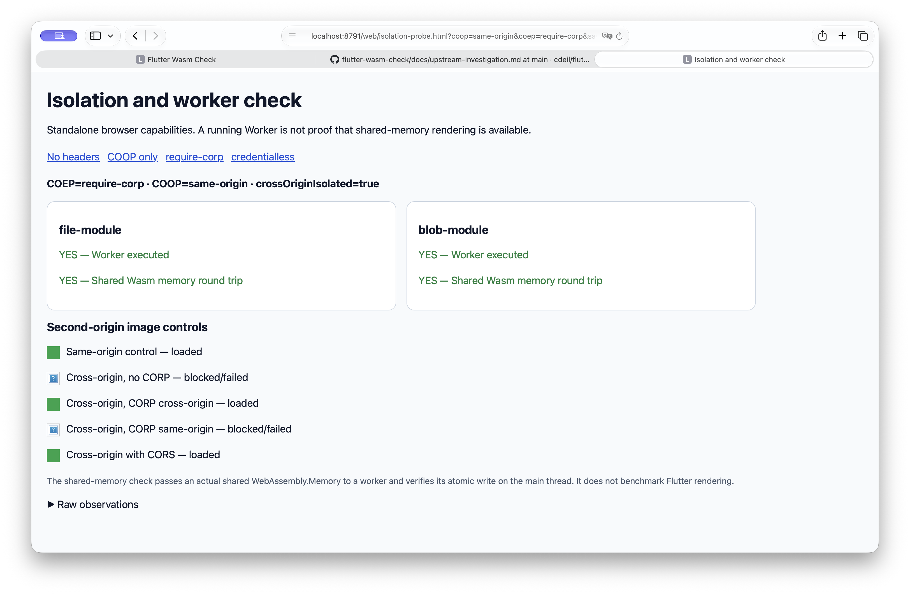
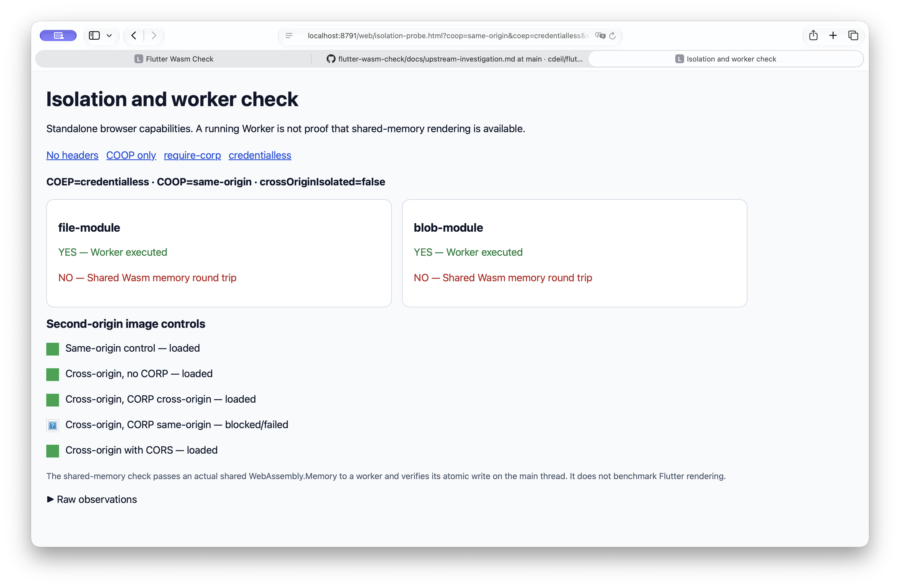

# Follow-up validation — 2026-11-06

There were useful checks to do before upstream submissions. They now establish
the Safari isolation boundary independently of Flutter, exercise actual shared
memory in workers, and close the Firefox engine-test gap. A small candidate-
targeted test/CI patch is available for review. Nothing has been posted upstream.

## Isolation: delivered headers versus working shared memory

[`isolation-probe.html`](../web/isolation-probe.html) has no Flutter dependency.
It checks the actual response headers, secure-context state and
`crossOriginIsolated`. Both a file module worker and a blob module worker must
send a ready message. The main thread then passes a shared
`WebAssembly.Memory` initialized to 41; the worker performs an atomic increment,
and the main thread must observe 42 in that same shared buffer.

The atomic operation is JavaScript operating on a real Wasm memory. This is a
shared-memory capability check, not execution of a compiled Wasm workload or
proof that a particular Flutter frame ran on a raster worker. It strengthens
the earlier constructor-count evidence without overstating what that count meant.

Four document policies and five image-resource controls were checked. Each
Playwright browser/host lane has three fresh contexts per policy. Vendor Linux
Firefox uses three fresh native browser processes per policy. Real Safari uses
one observed navigation per policy through Computer Use. The automated lanes
use 1440 × 900 / DPR 1; Safari preserves its existing zoom/display settings.

Start the same local server on two origins in separate terminals, then open
the probe or run the browser harness:

```sh
node tool/serve.mjs 8791
# Separate terminal:
node tool/serve.mjs 8792
# Separate terminal, after both are running:
node tool/isolation.mjs chromium
```

Open `http://localhost:8791/web/isolation-probe.html` for the manual controls.
`BROWSER_PATH` selects a vendor Chromium binary and `OUT` selects the result
file. Use localhost or HTTPS so the page has a secure context. The second
origin is required for the resource controls; it defaults to the next port.

| Browser / host | Document cases | No headers | COOP only | COOP + require-corp | COOP + credentialless |
| --- | ---: | --- | --- | --- | --- |
| Chrome for Testing 157.0.8103.38 / macOS | 12 | off | off | on | on |
| Chrome for Testing 157.0.8103.38 / Linux | 12 | off | off | on | on |
| Playwright patched Firefox 157 / macOS | 12 | off | off | on | on |
| Playwright patched Firefox 157 / Linux | 12 | off | off | on | on |
| Vendor Firefox 159.0.1 / Linux, native CLI | 12 | off | off | on | on |
| Real Safari 27.2 / macOS 27.2 | 4 | off | off | on | off |

**On** means isolation is true and both shared-memory round trips pass. **Off**
means isolation is false and both shared-memory round trips fail as expected.
Both workers execute in every case, including every **off** case. Worker
creation or execution alone therefore cannot establish multithreaded rendering
availability. All 64 document cases pass the recorded contracts.





The second local origin makes the deployment tradeoff visible. An image without
CORP/CORS permission is blocked under `require-corp`, whereas explicit
`CORP: cross-origin` and CORS opt-in allow it. An explicit `CORP: same-origin`
image is blocked across origins even in the negative controls. These expected
resource failures are retained; they are not application rendering failures.
This tests image permission boundaries, not authentication, cookies, external
iframes, PDF integrations, popups or every third-party service.

The first native Firefox screenshot attempt finished without completed probe
records because the page's implicit body defeated the server's load-gate
insertion. The result audit rejected it. Explicit body markup and robust gate
insertion fixed the harness; all 12 native cases then produced complete results.
The rejected attempt is not interpreted as a Firefox capability failure.

## The Safari issue already has an upstream home

[WebKit 230550](https://bugs.webkit.org/show_bug.cgi?id=230550) specifically tracks
implementing `COEP: credentialless`. It is NEW and unassigned at inspection.
The inspected current WebKit source explicitly classifies the token as
unsupported, and its parser accepts `require-corp`. The immutable source pin is
recorded in [the follow-up metadata](../results/2026-11-06-followup/upstream-status.json).
This source inspection is not claimed to identify the exact Safari release binary.

This finding adds a precise existing feature ticket to the earlier report.
It does not establish a new Wasm compilation bug. Safari's default Flutter
enablement ([178893](https://github.com/flutter/flutter/issues/178893)) and canvas
performance ([WebKit 267291](https://bugs.webkit.org/show_bug.cgi?id=267291)) are
separate questions. Merely accepting the header token would not implement its
fetch/credential semantics; no WebKit implementation patch is claimed here.

The [Flutter guide's HTTP-server section](https://docs.flutter.dev/platform-integration/web/wasm#serve-the-built-output-with-an-http-server)
already lists both COEP values. A useful docs contribution would add a runtime
verification/troubleshooting step, rather than repeat that list or file a
duplicate WebKit bug. [Proposed diagnostic wording](../drafts/flutter-wasm-isolation-diagnostic.md)
is saved for human review. The fresh raw evidence also supports a narrowly
scoped update to the existing Safari issue, without claiming mobile qualification.

## A concrete Firefox test/CI patch

The original worker-mode tests intentionally skip two context-creation mocks:
the overridden browser API is local to the main thread. The existing non-isolated
Firefox UI lane does not run the Skwasm-specific bundle. Adding its non-isolated
counterpart executes the skipped behavior in the correct runtime mode.

The [local patch](../patches/firefox-single-thread-unit-lane.patch) targets
candidate `b09e6cabd227035bc209757ae9586b7454049797` from Flutter PR 195105. It adds:

- A non-isolated Firefox Skwasm unit suite using the existing `firefox-wasm` configuration.
- The suite to the Linux CI artifact-copy selection and an explicit CI run task.

The CI builder selects suites by name and
[pins Firefox 148.0](https://github.com/MarlonJD/flutter/blob/b09e6cabd227035bc209757ae9586b7454049797/engine/src/flutter/ci/builders/linux_web_engine_test.json#L427).
A YAML-only addition would not have connected the lane to that job. The complete
patch was checked for clean application and the modified builder JSON was parsed.
The **entire eight-file Skwasm unit bundle** was then executed locally:

| Vendor browser | Runtime | Passed | Skipped | Pipeline exit |
| --- | --- | ---: | ---: | ---: |
| Firefox 148.0, pinned CI browser version | non-isolated / skwasm_st | 54 | 0 | 0 |
| Firefox 159.0.1, current release | non-isolated / skwasm_st | 54 | 0 | 0 |

An earlier focused run passed 41 cases; the full-bundle runs above supersede its
coverage count. The test logs include the actual browser version and
`skwasm_st` runtime dimension. The initial full run compiled the bundle; the
second reused that same compiled bundle. Source changes were reverted from the
engine checkout after exporting the patch. No upstream branch was pushed.

After following the [candidate build prerequisites](hybrid-experiment.md):

```sh
# From the pinned Flutter checkout:
git apply /path/to/flutter-wasm-check/patches/firefox-single-thread-unit-lane.patch
cd engine/src/flutter/lib/web_ui
FIREFOX_EXECUTABLE=/path/to/vendor/firefox DISPLAY=:0 \
  dev/felt test --suite=firefox-dart2wasm-skwasm-skwasm --offline
```

This is candidate-targeted code for maintainer review, not a claim of a complete
upstream CI/presubmit run. Local Linux graphics and infrastructure differ from
the actual CI machine, and Skia Gold baselines were not checked on the detached
branch. A maintainer can decide whether to fold it into the existing stack or
rebase it after the dependent renderer work lands.

## What is ready, and what would still add evidence

| Contribution | Current readiness | Remaining work |
| --- | --- | --- |
| Firefox single-thread test coverage | Tested patch, full bundle on CI baseline and current vendor browsers | Human review, upstream rebase/placement and actual presubmits |
| Mozilla bitmap-copy evidence | Current release/Nightly reproduction already available | Human-edited concise comment; a C++ fix still needs profiling, ownership/lifetime design and implementation tests |
| Flutter isolation diagnostic | Controlled header/worker/resource matrix, real Safari screenshots and existing WebKit ticket | Review the small wording change against current docs; avoid duplicate instructions/status pings |
| Browser default enablement / product rollout | Stronger desktop evidence | Physical mobile/older versions, deployment integrations and continuous presentation qualification before a broad enablement claim |

The first three can move to human-reviewed contributions without waiting for
every production-qualification item in the last row. More desktop timing runs
alone would not close those remaining device/integration gaps. All proposed
comments and patches remain unposted.

Raw records, logs, screenshot proofs, versions and a checksum manifest are in
[`results/2026-11-06-followup/`](../results/2026-11-06-followup/).
