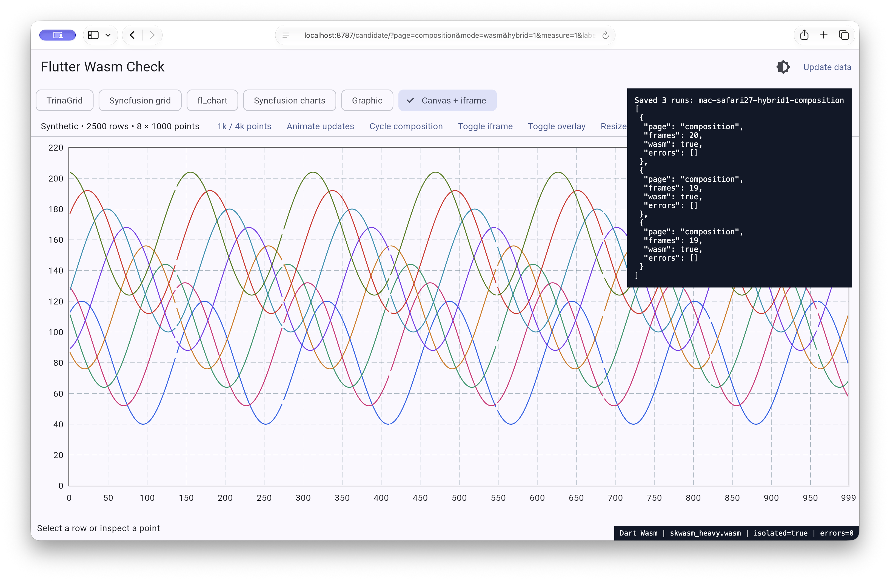
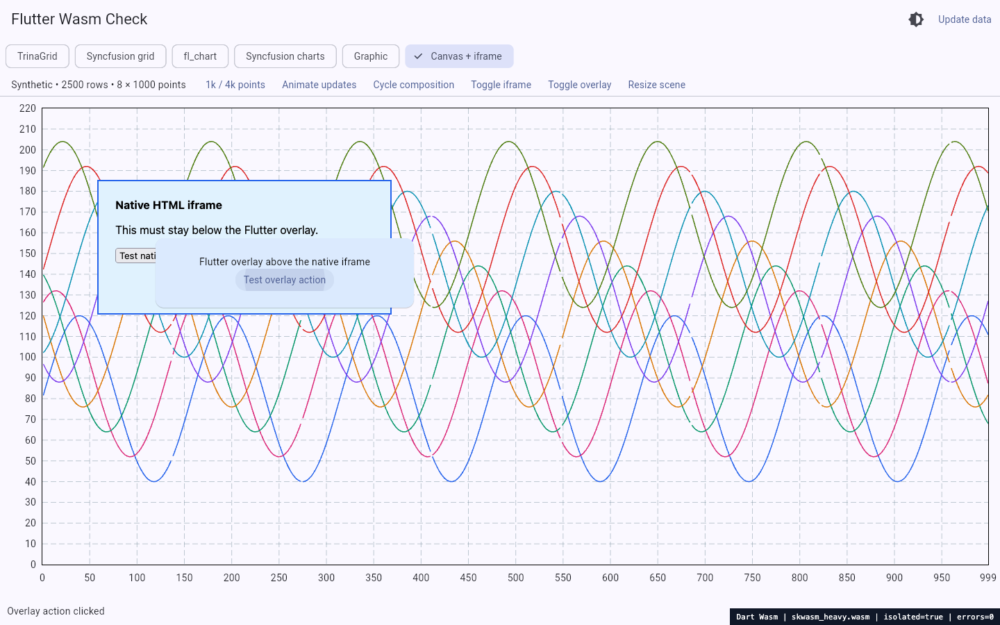
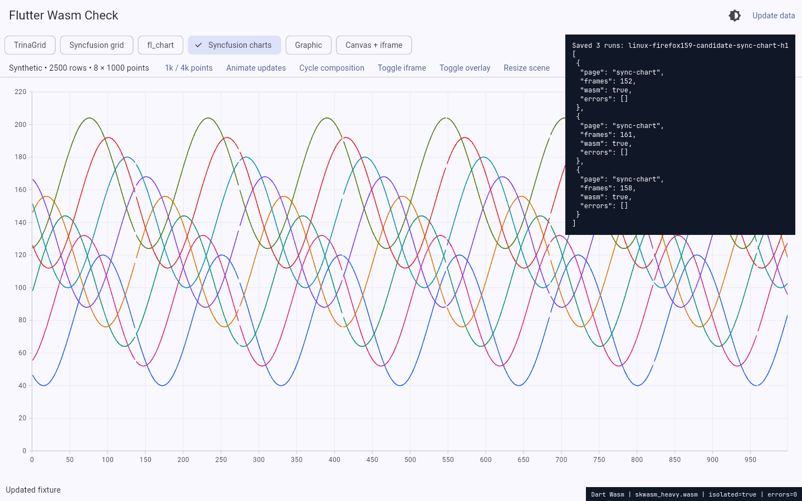

# Local hybrid-renderer experiment — 2026-11-06

The most useful route to a Flutter contribution is to help validate the existing
[195105 candidate](https://github.com/flutter/flutter/pull/195105), rather than
write another competing renderer or force a default enablement change. This
experiment builds its real Dart and native Skwasm code and compares its bitmap
and hybrid paths using the **same bundle**. It is not a production release.

## Exact candidate and local build

Candidate: `b09e6cabd227035bc209757ae9586b7454049797` from
`MarlonJD/flutter`, branch `skwasm-hybrid-opt-in`. Its DEPS-pinned prebuilt Dart
SDK reports `3.15.0-62.0.dev`. The Flutter content hash is
`55b8ed75b2475807a25d2386b5e8256ddeea7208`.
The stable comparison SDK is separately pinned in `references/flutter`.
`references/flutter-hybrid` pins the candidate source for inspection. The
evaluated depot_tools revision was `500126d6e351e4f0834b70f71b454ce5c3733c54`.

[`tool/build-hybrid-linux.sh`](../tool/build-hybrid-linux.sh) records the Linux
procedure. The evaluated build was made with the equivalent steps manually;
the convenience script has syntax validation, not a second full clean build.

1. Check out the exact candidate, initialize its standard `.gclient` with
   `download_emsdk: True`, and run `gclient sync --no-history` using depot_tools.
2. Build the Web SDK and both runtime variants with `felt build sdk skwasm`
   and `felt build skwasm_heavy`. Both native builds completed locally; the heavy
   artifact is required for explicitly opted-in Gecko/WebKit.
3. Use the candidate's matching prebuilt Dart and locally built Web SDK. The
   feature-tree content hash had no published Flutter tool-cache ZIPs (404), so
   host/pub support caches were bootstrapped from an existing Linux 3.47.8 SDK
   (`STABLE_FLUTTER` can select that cache in the helper). The tested stable
   application SDK remains 3.47.9. The
   runtime binaries and Web SDK kernels came from the candidate build, not from
   those borrowed host caches.
4. A **local-only** `3.51.0-0.0.pre` Git tag let pub resolve the shallow feature
   tree's Flutter constraint. This is not an official Flutter version and must
   never be pushed as one. Build identity is the commit/DEPS/artifact hashes.
5. Build profile output with `--local-engine-src-path=.../engine/src`,
   `--local-web-sdk=wasm_release`, `--wasm`, `--no-tree-shake-icons` and
   `--no-web-resources-cdn`. Build the minimal entry separately. The resulting
   browser bundles run on both hosts; no macOS engine cross-build is claimed.

Normal `make build` still uses stable Flutter. The experimental build has a
separate output directory and dependency resolution; the dashboard package
release pins are unchanged. Developer tooling bootstrap is a reproducibility
limitation, not evidence that this patch has shipped in a supported SDK.

## A/B method and runtime proof

The only A/B switch within a candidate bundle is `?hybrid=0` versus `?hybrid=1`
(`skwasmUseHybridRasterizer` in the loader configuration). Each is tested with
worker Wasm and forced single-threaded Wasm under `require-corp` isolation.
Stable comparisons use a different engine/SDK and cannot isolate this flag.

In Firefox's four eligible dashboard pages, the bitmap runs have one visible
untransferred canvas. Hybrid runs have a hidden bitmap canvas and a visible
transferred direct canvas, with the requested worker count. This is stronger
path evidence than trusting that a URL flag was accepted. A transferred canvas
alone does not establish correct content or smooth physical presentation.

The [measurements](measurements-2026-11-06.md) describe the explicit frame window
and timing limitations. The candidate's integration cases use three repetitions
per configuration. Grid gains are materially larger than those of the heavy
Syncfusion chart, which still has other build/raster costs.



The native Safari capture verifies a rendered state and three completed
composition commands with zero captured errors. It is not a frame-by-frame
transition recording. Its old unwindowed timing list is not used as an A/B
performance table.

## Correctness checks that can help upstream

The integration harness [`tool/composition.mjs`](../tool/composition.mjs)
clicks real controls, checks the Flutter overlay action, types into a native
iframe input, resizes the scene, and compares the restored plot across three
round trips per bitmap/hybrid × worker/single-thread configuration.

The smaller [`lib/minimal_composition.dart`](../lib/minimal_composition.dart)
has no chart/grid imports. It paints an eight-bit frame number behind the
platform view and in the Flutter overlay. [`tool/minimal.mjs`](../tool/minimal.mjs)
requests 36 states per configuration, changes the actual browser viewport,
and decodes both screenshot regions. It saves the first mismatch and polls at
50 ms intervals for at most two seconds. Two rAFs are a first sampling point,
not a browser presentation fence. A delayed first snapshot and failure to
converge are recorded separately. This remains sampled screenshot evidence,
not an every-refresh physical-display recording.



This multi-surface scene exercises the bitmap fallback; it is not labeled a
single direct-canvas scene. The selected text confirms the overlay action.

On macOS, patched Firefox 157 and Chrome 156 each passed all 144 requested
states (36 × four configurations), with no captured runtime errors. Firefox's
hybrid worker lane had one initially stale sample that converged on the next
snapshot; the first PNG and both decoded observations are retained. The other
seven browser/configuration combinations matched on their first sampled PNG.
The integration harness also passed all four Firefox configurations, with
three interactive round trips each and identical restored plot pixels.
This is useful positive evidence, not a confirmed engine regression or proof
that every intermediate displayed frame was correct.

The corresponding Linux patched Firefox 157 and headless Chrome 154 checks
also converged for all 144 states per browser. Chrome had one stale first
snapshot; patched Firefox had none. Across these four browser/host lanes,
all 576 requested states converged, with two first-snapshot delays retained.
Linux's Firefox integration harness passed the same four configurations and
three interactive round trips each. No continuous-display qualification is
inferred from those eventual matches.

Existing candidate engine tests already cover promotion, unstable size, failed
direct setup, readback errors and surface callbacks:

- `test/skwasm/hybrid_canvas_rasterizer_test.dart`
- `test/skwasm/surface_test.dart`
- `test/skwasm/surface_callback_test.dart`
- `test/ui/platform_view_commit_test.dart`

The useful next patch would adapt a confirmed missing regression to those
engine-owned tests. It should not introduce Syncfusion or a dashboard dependency
to Flutter's engine. The `felt` Firefox runner launches a vendor browser process
and communicates through the Dart test harness; it is not Selenium. Its
`FIREFOX_EXECUTABLE` override supports a disposable vendor binary, while
Playwright continues to drive the application integration tests.

The focused upstream suites were executed against vendor Firefox 159.0.1 on
Linux, using the candidate's compiled test bundles and runtime artifacts:

```sh
export PATH="/path/to/depot_tools:$PATH"
dev/felt build wimp
FIREFOX_EXECUTABLE=/path/to/vendor/firefox DISPLAY=:0 \
  dev/felt test --browser=firefox --compiler=dart2wasm --renderer=skwasm \
  --offline test/skwasm/hybrid_canvas_rasterizer_test.dart \
  test/skwasm/surface_test.dart test/skwasm/surface_callback_test.dart \
  test/ui/platform_view_commit_test.dart
```

The initial invocation passed its assertions but the overall pipeline failed
because the general artifact copier also required `wimp.js`. After building
that matching artifact, `felt test --run --copy-artifacts` completed with exit
zero. The UI suite passed five cases in each of its single-thread/worker lanes;
the isolated Skwasm suite passed 39 cases and skipped two. Those two context-
creation mocks are intentionally skipped in worker mode because the override
is local to the main thread. That is 49 case passes across the three lanes,
not 51 passes. Skia Gold baselines were not checked on the detached branch.
The [sanitized runner log](../results/2026-11-06/engine-tests-firefox159.log)
retains the actual version, assertions, skips and graphics diagnostics. These
are focused unit assertions, not the entire Flutter engine or golden suite.

## Contribution boundary

PR 195104's DOM commit order, 195105's hybrid lifetime/promotion logic and
195106's desktop policy are distinct review questions. Single-canvas speed
does not qualify platform-view transitions, and those transitions do not
qualify mobile browsers or all isolation/embedding combinations. Default
browser allow-list decisions need their own review and release integration.

This repository contains local results and [unposted feedback](../drafts/).
It makes no Firefox patch claim, upstream submission, maintainer commitment
or release-date prediction.

## Candidate A/B results

Median Flutter frame-start rates across three repetitions, on the same engine
and fixture. Worker and single-threaded modes are separate comparisons.
The two Linux Chromium rows use headless SwiftShader; Firefox rows use its
reported native WebGL backend. These are not displayed FPS.

| Browser / host | Page | Threads | Bitmap | Hybrid |
| --- | --- | --- | ---: | ---: |
| mac-firefox157 | trina-grid | worker | 35.63 | 63.13 |
| mac-firefox157 | trina-grid | single | 22.80 | 48.73 |
| mac-firefox157 | sync-grid | worker | 38.89 | 58.20 |
| mac-firefox157 | sync-grid | single | 30.47 | 46.19 |
| mac-firefox157 | fl-chart | worker | 50.64 | 60.38 |
| mac-firefox157 | fl-chart | single | 36.56 | 47.36 |
| mac-firefox157 | sync-chart | worker | 25.97 | 26.46 |
| mac-firefox157 | sync-chart | single | 21.33 | 25.38 |
| linux-firefox157 | trina-grid | worker | 57.53 | 60.06 |
| linux-firefox157 | trina-grid | single | 39.61 | 60.05 |
| linux-firefox157 | sync-grid | worker | 58.27 | 59.35 |
| linux-firefox157 | sync-grid | single | 46.17 | 59.91 |
| linux-firefox157 | fl-chart | worker | 59.93 | 59.84 |
| linux-firefox157 | fl-chart | single | 50.77 | 59.96 |
| linux-firefox157 | sync-chart | worker | 30.57 | 37.46 |
| linux-firefox157 | sync-chart | single | 26.71 | 33.10 |
| mac-chrome | trina-grid | worker | 60.09 | 60.22 |
| mac-chrome | trina-grid | single | 60.00 | 60.00 |
| mac-chrome | sync-chart | worker | 47.44 | 33.70 |
| mac-chrome | sync-chart | single | 41.76 | 38.47 |
| linux-chrome | trina-grid | worker | 59.76 | 60.15 |
| linux-chrome | trina-grid | single | 58.51 | 58.14 |
| linux-chrome | sync-chart | worker | 3.35 | 3.17 |
| linux-chrome | sync-chart | single | 3.27 | 3.29 |

Raw build/raster/span/jitter statistics and frame windows remain in
[`summary.json`](../results/2026-11-06/summary.json) and its input files.
Performance alone does not qualify promotion/overlay lifetime or the proposed
default policy. The heavy chart retains substantial work beyond bitmap transfer.

The first Chrome 156 series showed a variable worker-chart decline (median
47.44 bitmap versus 33.70 hybrid), so it was retested rather than reported as
a confirmed browser/engine regression. With Chrome 157.0.8103.38 and a fresh
process per flag/repetition, alternating bitmap/hybrid, the three worker rates
were 47.51/46.01/45.31 versus 50.03/46.86/50.13. Single-thread medians were
41.27 versus 40.86. The large decline did not reproduce under those changed
conditions; the browser version and process strategy both changed, so this
does not identify a cause or prove a version fix. The
[confirmation data](../results/2026-11-06/windowed-mac-chrome157-hybrid-confirmation.json)
retains every sample. PR 195106 already excludes worker Chromium from its
proposed defaults; a new blanket-enable or regression claim would be premature.

## Current vendor Firefox confirmation

Vendor Firefox 159.0.1 on Linux was also run directly, without Playwright's
patched Firefox or WebDriver. The official CLI's headless screenshot mode waits
on the local server's completion gate. The desktop was unlocked/on with idle
inhibition. Each URL runs three in-page samples, not independent contexts;
viewport is 1440 × 900 / DPR 1. Both paths create one worker and use the same
candidate Dart/runtime binaries. Only the browser-side recording/proof script
was refreshed to use the corrected timing window.

| Page | Bitmap frame starts/s | Hybrid frame starts/s |
| --- | ---: | ---: |
| TrinaGrid | 44.20 | 56.54 |
| Syncfusion chart | 30.87 | 39.09 |

All three hybrid samples per page show a visible transferred canvas; bitmap
samples show none. Captured errors are empty. This is current vendor evidence
of approximately 27–28% higher frame-start throughput for these worker cases,
with the in-page repetition and headless limitations stated above. It is not a
Firefox fix or a physical-display benchmark. The
[raw native A/B](../results/2026-11-06/linux-firefox159-candidate-native.jsonl)
and [`native-firefox-candidate-linux.sh`](../tool/native-firefox-candidate-linux.sh)
provide the reduction and procedure.


