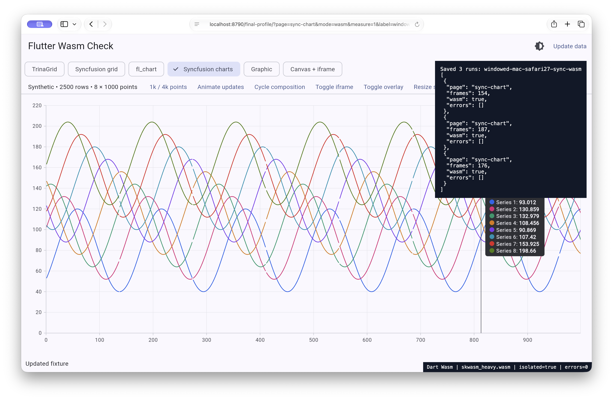
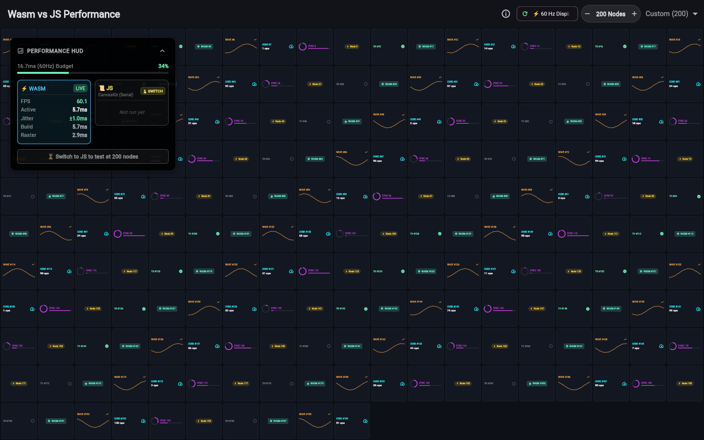

# Measurements — 2026-11-06

Wasm makes several demanding interactions faster in this fixture. It is not a
universal speed multiplier, a measured startup improvement, or proof that every
browser should be opted in. The strongest remaining Firefox bottleneck is the
bitmap-creation/presentation path. See the [hybrid experiment](hybrid-experiment.md)
for a locally built candidate that avoids it in eligible scenes.

## What the blog comparison establishes

The [Flutter article](https://flutter.dev/blog/try-flutter-web-with-webassembly-week)
reports a particular 200-node workload on Chrome 151 / M4 Pro: roughly twice the
frame throughput, 2.5 times faster building, reduced timing jitter, and a small
compressed-size change. Those figures are workload/hardware measurements, not
minimum gains for all Flutter apps. This rerun uses the pinned public demo,
explicitly selects 200 nodes, and changes the browser/CPU/SDK. It tests the
direction and size of the effect; it does not recreate the original machine.

The dashboard adds heavy grids, sparse multi-series charts and native HTML
composition. All five package pages compile to Wasm without package-source
patches. Synthetic data has no network/backend component.

## Machines and measurement method

| Host | Environment |
| --- | --- |
| macOS | macOS 27.2 (26B123), Apple M3, 8 CPU cores, 16 GB RAM |
| Linux | Omarchy 4.0.4, Linux 7.2.5-3-omarchy, Intel i5-14600K, NVIDIA RTX 4060 Ti 16 GB, driver 610.57.04 |

Automated comparisons use Playwright 1.64.0, 1440 × 900 CSS pixels and DPR 1.
The initial matrix and Mac Chrome 157 use headless browsers. Linux Chrome 157
is additionally run **visibly**, with its NVIDIA hardware backend verified;
the initial Linux headless Chromium lanes use SwiftShader. Linux uses
`DISPLAY=:0` and the existing user runtime directory;
the Firefox lane needs a usable display/GPU configuration even in headless mode.
Real Safari and installed macOS Firefox are checked separately through Computer
Use. Playwright's patched Firefox is identified explicitly. WebKit automation
is not labeled Safari. No Selenium is used in these public experiments.

The stable app is built with Flutter 3.47.9 / Dart 3.13.7 in **profile** mode for
frame timings. Release output is used only for the size calculation. Compiler
choice is read from `dart.tool.dart2wasm`; resources, isolation, workers, canvas
dimensions and errors are saved in each result. A CanvasKit `.wasm` resource is
not evidence that the Dart application itself was Wasm.

The repeated Playwright dashboard comparisons get three independent browser
contexts; the broad latest-Chrome smoke matrix has one per page/mode and is
not a repeated performance comparison. Native Safari and vendor Firefox URL
captures run three repetitions within a page, with a fresh navigation/process
between modes; they are identified separately. After two seconds of
settling and a neutral update, the grid scrolls for four seconds, or the chart
updates continuously for four seconds. The composition action deliberately
changes state only every 200 ms; its sparse frame count is **not** an achievable
FPS comparison. The reference demo gets a fresh browser process per sample,
ten seconds warmup and six seconds recording. Timed runs on a host are serial;
engine builds and other heavy checks are kept outside those runs.
Modes run in the harness's fixed order, not a randomized crossover. Three
repetitions on one machine per OS are useful checks, not population estimates
or confidence intervals. Compare like-for-like rows before drawing conclusions.

Frame lists are bounded by explicit `performance.now()` start/end timestamps.
Flutter batches timing callbacks: clearing a list at the start is insufficient
because a queued startup frame can arrive later. The raw callback list and the
filtered window are both retained. A later neutral update flushes the final
batch, and its frame is excluded. Earlier unwindowed exploratory throughput
numbers were rejected. This correction removed a spurious worker slowdown.

For each repetition, frame-start rate is `(n−1)/(lastStart−firstStart)` and jitter
is the sample standard deviation of positive successive start intervals. Tables
use the median of three repetition-level statistics. Build/raster/span values
are means within each repetition, then medians across repetitions. Raster
duration can include asynchronous presentation waits. These values are Flutter
instrumentation, **not physically displayed FPS**, browser interaction latency,
or a claim that garbage collection has disappeared. Headless scheduling can
also exceed or differ from the physical monitor refresh rate.

## Bitmap-copy microbenchmark

[`web/copy-probe.html`](../web/copy-probe.html) clears a WebGL canvas, then either
creates/transfers an ImageBitmap or submits to a direct canvas. It varies
512/1024/2048-square surfaces and alpha true/false, with ten warmup and 100 timed
calls per case. Creation and destination transfer are timed separately. Pixel
checks happen outside the timed loop. The normal automated lanes repeat in
three contexts; vendor-native probes state their smaller sample count.

The Firefox bitmap-creation cost grows strongly with surface area. Current
Nightly still reproduces it. Cheap direct submission does not demonstrate zero
GPU work or a complete fix. Some native Firefox direct-path source snapshots
are blank. The probe uses `preserveDrawingBuffer=false` and reads the source
after two rAFs: the [WebGL specification](https://registry.khronos.org/webgl/specs/latest/1.0/#THE_DRAWING_BUFFER)
permits the drawing buffer to be cleared after presentation, so that late
readback is **not a valid direct-display correctness assertion**. The raw
`correct=false` observations remain for transparency; they are not browser
failures. [`copy-lifecycle.html`](../web/copy-lifecycle.html) separately checks
an immediate drawing-buffer read and a late source snapshot with preservation
off/on. Neither the cheap direct timing nor that snapshot qualifies a renderer.
The timed probe
does not emulate Flutter's worker, overlays, texture ownership or lifecycle.

## Selected bitmap timings

Selected 2048-square bitmap-path synchronous medians (milliseconds).
Each case has 100 calls after ten warmups;
three-context rows are the median of those context medians. Native rows have
one context. All listed bitmap pixel checks passed.

| Browser / host | Contexts | Alpha | Create bitmap | Entire API loop |
| --- | ---: | --- | ---: | ---: |
| Mac Chrome 157 headless | 3 | true / false | below timer resolution | 0.005 / 0.005 |
| Mac Playwright Firefox 157 headless | 3 | true | 6.74 | 7.02 |
| Mac Playwright Firefox 157 headless | 3 | false | 7.18 | 7.46 |
| Mac vendor Firefox 159.0.1 visible | 1 | true | 10.14 | 10.62 |
| Mac vendor Firefox 159.0.1 visible | 1 | false | 10.56 | 10.88 |
| Mac Safari 27.2 visible | 1 | true | 4.54 | 4.62 |
| Mac Safari 27.2 visible | 1 | false | 3.48 | 3.68 |
| Linux vendor Firefox 159.0.1 headless | 1 | true | 9.76 | 9.82 |
| Linux vendor Firefox 159.0.1 headless | 1 | false | 10.74 | 10.86 |
| Linux vendor Nightly 162.0a1 headless | 1 | true | 9.84 | 9.92 |
| Linux vendor Nightly 162.0a1 headless | 1 | false | 12.04 | 12.16 |

Zero/below-resolution values do not mean zero GPU work. Headless/visible,
patched/vendor, privacy timer precision and graphics backend differ; the table
identifies a persisting expensive stage, not a controlled version-regression test.

## Release bundle size

The [raw size calculation](../results/2026-11-06/bundle-size.json) sums the Dart
application and selected renderer/runtime files, compressed individually. It
excludes common fonts/assets/bootstrap and the unused fallback. The ordinary
dual build still ships both compiler variants on disk.

| Selected core | Raw bytes | Gzip bytes | Brotli bytes |
| --- | ---: | ---: | ---: |
| JS + generic CanvasKit (Firefox/Safari) | 11,156,121 | 4,045,042 | 3,132,407 |
| JS + Chromium CanvasKit (Chrome/Edge) | 9,299,564 | 3,192,843 | 2,414,610 |
| Wasm + Skwasm (Chrome/Edge) | 6,842,018 | 2,718,935 | 2,136,480 |
| Wasm + heavy Skwasm (Firefox/Safari) | 8,464,633 | 3,467,659 | 2,785,935 |

The browser-paired selected Wasm cores are about 11% smaller with Brotli in this
fixture. Comparing normal Skwasm with generic CanvasKit would exaggerate the
Chromium saving: Chrome actually loads the smaller Chromium CanvasKit variant,
while Firefox/Safari load generic CanvasKit or heavy Skwasm. Runtime resource
proof confirms those paths. This
supports a favorable size outcome here; it does not reproduce an entire
deployed application's on-wire size, startup latency or the article's exact
size methodology.

## Scope and rejected evidence

- The original 156 Chrome reference run stalled after a reused-process sample.
  It is exploratory evidence of a harness/demo/browser stall, not a diagnosed
  engine defect. Final reference runs use fresh processes and bounded cases.
- Early Linux Firefox captures without the display configuration, and an
  overlapping stale harness process, were rejected. Only the corrected serial
  campaign is used for the automated tables.
- A first visible Linux Chrome 157 attempt ran while the desktop was locked
  and powered down. Its timings were rejected. The final visible lane starts
  with the monitor on, lock marker absent, and a task-scoped idle inhibitor;
  display state is checked again afterward. No lock/password settings change.
- The saved native Safari/Firefox functional captures predate the timing-window
  correction. Use their compiler/error/canvas evidence and screenshots, not
  their raw frame lists for performance comparisons.
- The first dashboard campaigns used a Trina Total column with default numeric
  formatting. The final source preserves fractional totals, with a widget test;
  the targeted final Trina checks are identified separately. Monthly fields and
  chart fixtures are unchanged. This avoids pretending an older bundle was
  built from the final source.
- There are no cold/warm startup, hot-reload, API/network, power, memory,
  accessibility or long-session soak measurements. The 4,000-point control is
  available interactively; the standard timed charts use eight 1,000-point series.
- Native Safari evidence is macOS only. No physical iPhone/iPad, old OS matrix,
  Windows machine, external iframe/login integration, image-heavy gallery or
  PDF-rendering integration is qualified by these runs.

The raw files, exact binaries and comparative tables below are the evidence
for the conclusions; a screenshot proves a rendered state, not smooth delivery.

## Native Safari and current Firefox

The final Safari 27.2 (`22625.2.8.11.9`) comparison uses the real visible
browser at 1314 × 780 CSS pixels, reported DPR 2.299999952316284. Browser zoom/
display settings were preserved. Each number is the median of three in-page
samples using the corrected timing window, not three independent contexts.
Both Wasm runs use heavy Skwasm, isolation and a worker; all captured error
lists are empty.

| Safari page | JS frame-start rate | Wasm frame-start rate | JS / Wasm mean build ms |
| --- | ---: | ---: | ---: |
| TrinaGrid | 52.84 | 59.20 | 12.85 / 6.12 |
| Syncfusion chart | 26.76 | 43.59 | 23.99 / 12.90 |

The [raw native samples](../results/2026-11-06/mac-safari27-final-native.jsonl)
also include the new Safari copy and lifecycle probes. At 2048 square, bitmap
creation medians are 4.54 ms (alpha) and 3.48 ms (opaque), with one context.
These are not directly matched to headless/DPR-1 browser frame-rate rows.

The standalone lifecycle diagnostic on Safari 27.2 and vendor Linux Firefox
159.0.1 returned the expected immediate pixels in all four preservation/alpha
cases, and their late source snapshots also matched in this run. The immediate
read forces synchronization, so this is not an identical reproduction of the
original probe's late blank snapshots or a proof of their exact cause. The
specification is the reason those original late reads cannot establish a
display defect.

Current vendor Linux Firefox 159.0.1 was checked with the monitor on/unlocked
using its own headless CLI, not Playwright's patched build. All six Wasm pages
are visibly rendered in saved screenshots and the default Trina page selects
JS. At 1440 × 900 / DPR 1, medians of three in-page final-app samples are:

| Vendor Firefox page | JS frame starts/s | Wasm worker frame starts/s |
| --- | ---: | ---: |
| TrinaGrid | 20.83 | 46.12 |
| Syncfusion chart | 19.84 | 30.13 |

These are a separate vendor lane, not a controlled comparison against patched
Firefox 157. The [raw file](../results/2026-11-06/linux-firefox159-native.jsonl)
contains the current proofs, exact windows and graphics diagnostics. The first
vendor captures made while the desktop was locked were superseded by this
unlocked repeat. The candidate's additional same-binary vendor A/B is documented
in the [hybrid experiment](hybrid-experiment.md#current-vendor-firefox-confirmation).

## Initial installed-browser dashboard matrix

Median Flutter frame-start rate across three repetitions; profile build before
the Total-format fix. These are not physical-display FPS. Linux Chromium
headless uses SwiftShader software rendering (confirmed by the same-launch
copy probe); do not use these rows to rank hardware browser performance.
The composition action is deliberately sparse and is excluded from this table.

| Browser / host | Page | JS | Wasm worker | Wasm single thread |
| --- | --- | ---: | ---: | ---: |
| mac-chrome 156.0.8078.80 | trina-grid | 55.53 | 60.04 | 60.00 |
| mac-chrome 156.0.8078.80 | sync-grid | 46.62 | 59.75 | 59.74 |
| mac-chrome 156.0.8078.80 | fl-chart | 46.60 | 60.17 | 60.00 |
| mac-chrome 156.0.8078.80 | sync-chart | 25.23 | 49.36 | 41.22 |
| mac-chrome 156.0.8078.80 | graphic | 40.13 | 58.68 | 53.58 |
| mac-firefox157 157.0 | trina-grid | 16.58 | 38.20 | 26.24 |
| mac-firefox157 157.0 | sync-grid | 21.27 | 40.60 | 29.09 |
| mac-firefox157 157.0 | fl-chart | 28.87 | 53.17 | 39.24 |
| mac-firefox157 157.0 | sync-chart | 19.87 | 26.19 | 21.52 |
| mac-firefox157 157.0 | graphic | 23.40 | 22.64 | 18.76 |
| linux-chrome 154.0.8037.97 | trina-grid | 32.22 | 59.81 | 58.76 |
| linux-chrome 154.0.8037.97 | sync-grid | 40.34 | 59.54 | 58.76 |
| linux-chrome 154.0.8037.97 | fl-chart | 12.24 | 15.97 | 14.79 |
| linux-chrome 154.0.8037.97 | sync-chart | 3.09 | 3.32 | 3.28 |
| linux-chrome 154.0.8037.97 | graphic | 12.52 | 15.22 | 14.19 |
| linux-edge 157.0.4341.42 | trina-grid | 29.67 | 59.87 | 58.02 |
| linux-edge 157.0.4341.42 | sync-grid | 39.34 | 59.52 | 58.69 |
| linux-edge 157.0.4341.42 | fl-chart | 11.93 | 15.95 | 14.76 |
| linux-edge 157.0.4341.42 | sync-chart | 2.93 | 3.26 | 3.06 |
| linux-edge 157.0.4341.42 | graphic | 12.37 | 15.41 | 14.13 |
| linux-firefox157 157.0 | trina-grid | 27.39 | 58.02 | 41.16 |
| linux-firefox157 157.0 | sync-grid | 37.33 | 58.41 | 47.28 |
| linux-firefox157 157.0 | fl-chart | 40.24 | 59.89 | 54.86 |
| linux-firefox157 157.0 | sync-chart | 24.57 | 31.10 | 26.79 |
| linux-firefox157 157.0 | graphic | 33.54 | 31.66 | 24.96 |

Raw frame counts, build/raster/span means and interval jitter are in
[`summary.json`](../results/2026-11-06/summary.json) and the corresponding
`windowed-*.json` files. For example, Mac Chrome 156 improves Syncfusion chart
frame-start rate from 25.23 to 49.36, whereas Graphic in patched Mac Firefox
is 23.40 with JS and 22.64 with worker Wasm. Both outcomes matter.

## Latest Chrome on the final dashboard

Chrome for Testing 157.0.8103.38, three fresh contexts per page/mode.
Mac is headless with its Metal backend; Linux is visibly running with NVIDIA
OpenGL. Linux display-state evidence is on/unlocked before and after, and
recorded documents are visible/focused. These are within-host compiler
comparisons, not a headless-versus-visible browser ranking.

| Host / page | Mode | Frame starts/s | Mean build ms | Mean span ms | Interval jitter ms |
| --- | --- | ---: | ---: | ---: | ---: |
| mac / trina-grid | js | 52.32 | 15.02 | 17.88 | 5.71 |
| mac / trina-grid | wasm | 59.99 | 6.66 | 10.54 | 1.05 |
| mac / trina-grid | st | 60.00 | 6.57 | 8.90 | 0.93 |
| mac / sync-chart | js | 24.97 | 27.92 | 39.64 | 2.83 |
| mac / sync-chart | wasm | 49.62 | 12.14 | 32.14 | 6.66 |
| mac / sync-chart | st | 41.33 | 9.71 | 23.80 | 2.01 |
| linux / trina-grid | js | 58.74 | 11.11 | 13.11 | 2.64 |
| linux / trina-grid | wasm | 60.03 | 6.00 | 7.93 | 0.41 |
| linux / trina-grid | st | 59.98 | 5.92 | 7.58 | 0.44 |
| linux / sync-chart | js | 27.86 | 23.48 | 35.52 | 2.11 |
| linux / sync-chart | wasm | 59.84 | 8.50 | 25.17 | 0.83 |
| linux / sync-chart | st | 45.62 | 7.99 | 21.47 | 1.28 |

The heavy chart roughly doubles its frame-start throughput on both hosts.
The grid is closer to the refresh/scheduling ceiling, although build time falls.
All 24 cases in each host's separate six-page × four-mode smoke matrix pass
compiler/error/timing checks; that one-repetition matrix is correctness evidence,
not a repeated speed estimate. Default selection is Wasm on these Chromium runs.

## Reference demo rerun

Pinned public demo, 200 nodes, Flutter 3.47.9, profile build, 1440 × 900 / DPR 1,
10-second warmup and 6-second explicit timing window, three fresh browser
processes per mode. The following rows use current Chrome 157.0.8103.38.

| Host | Mode | Frame starts/s | Mean build ms | Mean span ms | Interval jitter ms |
| --- | --- | ---: | ---: | ---: | ---: |
| mac | js | 59.49 | 12.63 | 15.32 | 0.99 |
| mac | wasm | 60.00 | 5.57 | 8.61 | 1.03 |
| mac | st | 60.00 | 5.92 | 7.93 | 0.74 |
| linux | js | 59.99 | 8.44 | 10.49 | 0.36 |
| linux | wasm | 59.98 | 3.58 | 5.20 | 0.37 |
| linux | st | 59.98 | 3.40 | 4.92 | 0.48 |

The current 200-node JS case is already near 60 frame starts/s on both hosts.
Wasm worker build time is about 2.3 times lower; mean span is about 1.8 times
lower on the Mac and 2.0 times lower on Linux. The exact advertised FPS/jitter
ratios do not repeat here: there is no doubled throughput at that ceiling, and
latest hardware-lane jitter is similar. The dashboard's heavier chart supplies
a different example with roughly doubled throughput. These results support
compiler/pipelining gains, not universal multipliers or disappearance of GC.

Supplementary fresh-process reference rows for installed Linux Chrome 154,
Edge 157 and patched Playwright Firefox 157 are in `summary.json`. The Linux
Chromium headless controls use SwiftShader; patched Firefox is not vendor
Firefox 159. The demo HUD uses a rolling 120-frame window and excludes intervals
over 500 ms; this report uses the full explicit window and retains long positive
intervals. Both raw HUD snapshots and timing arrays are saved.

